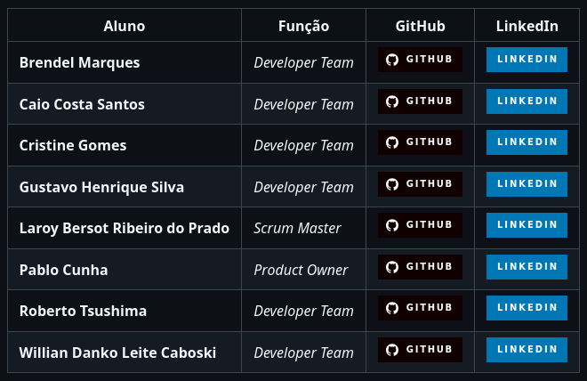
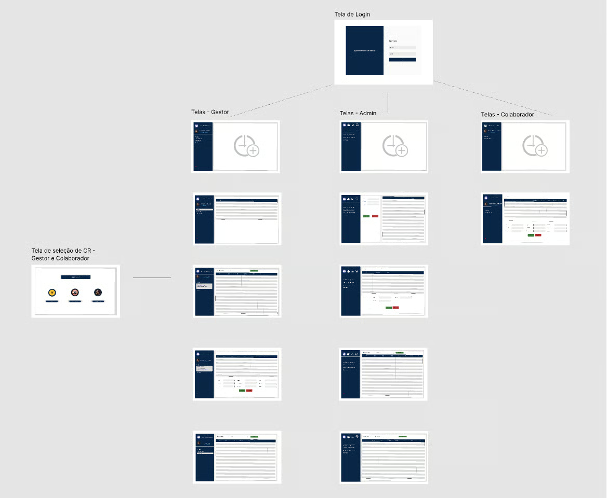
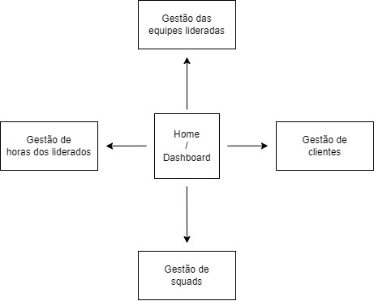

# Portfólio Fatec

# Willian Danko Leite Caboski

## Introdução

Olá, sejam bem-vindos.

Sou Willian Danko Leite Caboski, estudante do 6.º semestre de Banco de Dados na **Fatec Professor Jessen Vidal**.

Tenho 24 anos e atuo como analista de suporte e manutenção na [Geopeixel](https://geopixel.com.br/), empresa especializada no desenvolvimento de software para prefeituras e no processamento de arquivos GIS.

Atuei anteriormente na área industrial e optei por me especializar em TI para aprimorar minha atuação profissional e conquistar oportunidades em projetos que integrem automação industrial, programação, gestão e análise de dados e inteligência artificial. Meu objetivo é tornar‑me referência no desenvolvimento de soluções alinhadas à Indústria 4.0. Planejo ingressar na pós-graduação "Inteligência Artificial Aplicada a Processos Industriais", oferecida pela PUC Minas como proximo passo na minha carreira profissional.

## Meus Principais Conhecimentos

### Spring Boot

Estudo Java e o framework Spring Boot desde uma introdução no 4.º semestre do curso. Desde então, venho aprofundando conhecimentos em desenvolvimento backend com Spring Boot, incluindo construção de APIs REST, integração com bancos de dados e testes automatizados.

### STL e SCL

STL e SCL são linguagens de texto estruturado usadas na programação de CLPs (controladores lógicos programáveis). Aplicam-se a projetos de automação industrial para controlar processos e equipamentos. Devido à minha experiência na área industrial, venho me dedicando ao estudo dessas linguagens para aprimorar minhas competências em automação.

### Python, JavaScript e RPA

Utilizo Python e JavaScript para desenvolver soluções de RPA (Robotic Process Automation) que automatizam tarefas repetitivas. Exemplos incluem scripts para configuração de repositórios e documentos em novos projetos e rotinas de validação de metadados em bases de clientes.

### SQL

Ao longo da minha carreira, trabalhei principalmente com PostgreSQL, realizando manipulação e análise de dados de clientes. Na minha posição atual, construo relatórios e dashboards que cruzam informações espaciais, temporais e tabulares. Também possuo experiência com MySQL, Microsoft SQL Server e Oracle.

## Projetos integradores

Durante a minha gradução, trabalhei no desenvolvimento de projetos nomeados de "Projetos integradores". Um projeto integrador consiste em solucionar um problema do mundo real de clientes reais, parceiros escolhidos pela própria Universidade Acadêmica, utilizando os conhecimentos e ensinamentos adquiridos durante o decorrer dos semestres.

Abaixo, todos os projetos que realizei serão descritos, detalhando a "dor" que o cliente descreveu, a solução proposta (e entregue), e os aprendizados extraídos de cada um destes projetos.

### Entre em Contato:

- [LinkedIn](https://www.linkedin.com/in/willian-caboski/)
- [GitHub](https://github.com/DankoCaboski)

 

# Meus Projetos

 

# 1° semestre

## Projeto: Avaliação Democratizada

### Resumo do projeto

Este projeto foi desenvolvido tendo como cliente a própria FATEC São José dos Campos. O objetivo era criar uma aplicação que permitisse que os membros da instituição hipotética, a **PBLTeX**, avaliassem reciprocamente o desempenho de seus colegas em um processo de avaliação 360º.

Para muitos membros da equipe, esse foi o primeiro contato com a metodologia ágil. A fim de auxiliar os alunos nesse processo, a FATEC disponibilizou um professor para atuar como cliente e outros dois como orientadores Scrum, garantindo uma experiência o mais próxima possível de uma aplicação prática da metodologia Scrum.

### Tecnologias adotadas
A aplicação foi desenvolvida em Python, sem interface gráfica e sem banco de dados; todos os dados eram armazenados e manipulados em memória durante a execução.

### Projeto em funcionamento
O sistema era composto por três categorias de usuários: administradores, instrutores e alunos. Além disso, o sistema era dividido em turmas, formadas por alunos e instrutores. Para cada turma, um instrutor poderia atuar como Fake Client ou como Group Leader. Dentro de uma mesma turma, os alunos eram divididos em times, formados por um Líder Técnico, um Product Owner e demais membros.

Na hora da avaliação, um membro do time avaliava os outros membros, respondendo a cinco perguntas, cada uma com cinco opções de resposta. As respostas eram armazenadas em um arquivo de texto, permitindo a geração de relatórios com base nas avaliações realizadas. Um instrutor podia visualizar as avaliações de um aluno e gerar um relatório com as médias das avaliações. 
Além disso, um instrutor do tipo Fake Client avaliava os alunos que atuavam como Product Owner (PO), e um instrutor do tipo Group Leader avaliava os alunos que atuavam como Líder Técnico (LT).

### Contribuições pessoais

Atuei como desenvolvedor, focado em implementar novas funcionalidades e otimizar o código-fonte do projeto.

Arrays e tuplas

Fui encarregado de criar os dados mock que seriam utilizados para popular a ferramenta e, durante essa atividade, tive meu primeiro contato com arrays e pude aprender a armazenar dados em listas e tuplas na memória em Python.

Validações condicionais

Também tive a oportunidade de aprender a implementar validações condicionais, a fim de atender às regras de negócio da aplicação, criando funcionalidades como a melhoria dos laços de chamada dos candidatos e a adição de limitações condicionais nas perguntas.

Ordenações

Durante o desenvolvimento de tarefas relacionadas à chamada de alunos para a avaliação, pude aprender a utilizar funcionalidades built-in do Python para tratar strings em memória.

 

# 2° semestre

## Projeto: Gestão de horas laborais

### Resumo do projeto

A 2RPnet é uma empresa brasileira de tecnologia com mais de 20 anos de experiência em meios de pagamento, soluções antifraude e análise de dados, destacando-se por soluções inovadoras e serviços de alta qualidade em TI.

Em detrimento de suas demandas internas por uma melhor gestão dos colaboradores alocados em diferentes projetos e necessitando de uma melhor gestão dos mesmos, a empresa nos contatou, interessada em desenvolver uma solução que possibilitasse centralizar o lançamento de horas trabalhadas dos membros da empresa.

Os usuários do sistema têm a possibilidade de centralizar o lançamento de suas horas trabalhadas e fazer a gestão de suas cargas de trabalho. Os gestores de cada equipe podem fazer a análise baseada nos membros de suas equipes, como a construção de relatórios, além de também poder gerenciar o acesso de seus liderados. Já os administradores representavam o cargo de usuário master no sistema, podendo fazer a demissão dos funcionários e o controle dos gestores.

### Tecnologias adotadas

O projeto foi inteiramente construído em Java, fazendo uso do framework **JavaFX** para a construção da interface gráfica.

A implementação do JavaFX foi uma demanda técnica solicitada pela FATEC, com o objetivo de garantir o contato de todos os alunos com essa linguagem de programação, que é uma das primeiras apresentadas no curso.

### Projeto em funcionamento
A aplicação possuía três fluxos de uso diferentes, sendo todos disparados após o login no sistema, de acordo com o perfil do usuário em questão.

Quando o usuário logado for um colaborador, sua tela de início contém seu espelho de horas trabalhadas no mês e um botão que dispara um modal para a entrada de novos registros.

O login como gestor nos traz para uma tela contendo os registros mais recentes dos membros de sua equipe e, a partir desse ponto, podemos usar os filtros para realizar consultas aos dados com base em datas, colaboradores ou projetos específicos.

O último nível de acesso, e o de maior importância, é o de administrador. Nesse acesso, podemos fazer o cadastro e a deleção de membros da empresa e promover colaboradores ao cargo de gestor.

### Contribuições pessoais
Durante o desenvolvimento deste projeto, fui responsável pela elaboração dos arquivos que constituíam a estrutura básica das interfaces visuais, assegurando que cada componente estivesse otimizado para uma navegação intuitiva e eficiente. Além disso, trabalhei na implementação dos handlers, permitindo uma resposta ágil e funcionalidade precisa para interações do usuário, o que contribuiu para a estabilidade e a experiência do projeto como um todo.

Estrutura visual e navegação

Fui responsável por criar e organizar os arquivos que compunham a base das telas do sistema, garantindo que os elementos visuais estivessem bem distribuídos e que a navegação fosse intuitiva, além de assegurar uma uniformidade visual. Essa contribuição foi essencial para a usabilidade da aplicação, pois permitiu uma experiência de uso mais clara, direta e eficiente.

Handlers e interações do usuário

Também participei da implementação dos handlers, que permitiram controlar as ações do sistema em resposta às interações do usuário. Com isso, foi possível tornar o fluxo da aplicação mais funcional, reduzir problemas de comportamento e melhorar a estabilidade das telas e dos processos internos do software.

 

# 3° semestre

## Projeto: Gestão de horas laborais

### Resumo do projeto

A 2RPnet é uma empresa brasileira de tecnologia com mais de 20 anos de experiência em meios de pagamento, soluções antifraude e análise de dados, destacando-se por soluções inovadoras e serviços de alta qualidade em TI.

Em detrimento de suas demandas internas por uma melhor gestão dos colaboradores alocados em diferentes projetos e necessitando de uma melhor gestão dos mesmos, a empresa nos contatou, interessada em desenvolver uma solução que possibilitasse centralizar o lançamento de horas trabalhadas dos membros da empresa.

Graças o desenvolvimento tecnico apresentado pelos alunso e ao forte alinhamento do projeto apresentado pelo, nos foi proposto como projeto integrador para o 3° semestre, uma atualização total desse projeto, onde foram implementadas diversas melhorias e uma migração para web app foi aplicada.

Os usuários do sistema têm a possibilidade de centralizar o lançamento de suas horas trabalhadas e fazer a gestão de suas cargas de trabalho. Os gestores de cada equipe podem fazer a análise baseada nos membros de suas equipes, como a construção de relatórios, além de também poder gerenciar o acesso de seus liderados. Já os administradores representavam o cargo de usuário master no sistema, podendo fazer a demissão dos funcionários e o controle dos gestores.

### Tecnologias adotadas

#### Tecnologias 

- Spring Boot
- Hibernate
- Postman 
- Dbever      
- PostgreSQL  
 
#### Linguagens

- Java
- Javascript
- HTML & CSS

### Sobre a empresa

A empresa parceira desse projeto foi a 2RP, uma software house voltada para investigação de fraudes bancarioas em canais digitais e auditoria.

### Contribuições pessoais
Durante o desenvolvimento deste projeto, fui responsável pela otimização das chamadas ao backend e ao banco de dados, resultando em tempos de carregamento e respostas mais rápidos. Além disso, contribuí para o planejamento da arquitetura do lado do servidor, tornando o projeto mais escalável e seguro. Também participei do desenvolvimento de funcionalidades como a gestão de equipes, extração de relatórios e o lançamento de horas extras pelos colaboradores.

Os imapactosde minhas contribuições podem ser resumidos no tópicos a seguir:

- Otimização de requisições  
- Construção de rotas independentes para consultas
- Implementação de views no banco para simplificar 
- Redução do trafego de dados em requisições do frontend
- Implementação de regras de negócio no client side para redução de tempo de resposta

### Hard Skills desenvolvidas
As habilidades técnicas desenvolvidas em consequencia desse projeto foram várias, mas as mais evidentes foram as relacionadas a tratativa de dados e a implementação de regras de negócios do sistema 

- Data Transfer Object & ORM
- Arquitetura RESTfull 
- Spring security
- JWT

Essas atvidades me permitiram desenvolver minhas habilidades tecnicas, podendendo colocar em pratica conseitos e teorias que foram de grande valor para o enriquecimento de meu portifólio. 

### Backlog do produto

A aplicação foi triunfalmente entregue após 84 dias, sendo divida em 4 sprints de 21 dias.
A metodologia scrum foi implementada no desenvolvimeto desse projeto, seguindo uma tendencia de mercado, uma vez que essa modelo é amplamente usada no hambiente comercial.

O projeto foi dividido em 17 User stories que tinham a função de compartimentalizar as funções do projeto, parra poder guiar o desenvolvimento.

  

    <b>Milestones</b>
    <ul>
       <li>CRUD e funcionalidades básicas</li>
       <li>Gestão de equipes e extração de relatórios</li>
    </ul>
  

<table>
  <thead>
    <tr>
      <th>COMO</th>
      <th>GOSTARIA DE</th>
      <th>PARA</th>
      <th>PRIORIDADE</th>
      <th>SPRINT</th>
    </tr>
  </thead>
  <tbody>
    <tr>
      <td>Administrador</td>
      <td>Adicionar colaboradores e gestores, editar ou inativar</td>
      <td>Que o CR possa utilizar o sistema</td>
      <td>1</td>
      <td>1</td>
    </tr>
    <tr>
      <td>Administrador</td>
      <td>Adicionar novos clientes, editar ou inativar</td>
      <td>Que o CR possa utilizar o sistema</td>
      <td>2</td>
      <td>1</td>
    </tr>
    <tr>
      <td>Administrador</td>
      <td>Adicionar centro de resultado, editar ou inativar</td>
      <td>Que o CR possa utilizar o sistema</td>
      <td>3</td>
      <td>1</td>
    </tr>
    <tr>
      <td>Administrador</td>
      <td>Adicionar novos integrantes e nomear um gestor para um centro de resultado</td>
      <td>Que o CR possa trabalhar nos projetos</td>
      <td>4</td>
      <td>1</td>
    </tr>
    <tr>
      <td>Colaborador</td>
      <td>Lançar minhas horas extras</td>
      <td>Serem registradas e aprovadas por um gestor</td>
      <td>5</td>
      <td>1</td>
    </tr>
    <tr>
      <td>Colaborador</td>
      <td>Lançar meus sobreavisos</td>
      <td>Serem registradas e aprovadas por um gestor</td>
      <td>6</td>
      <td>1</td>
    </tr>
    <tr>
      <td>Gestor</td>
      <td>Lançar minhas horas extras</td>
      <td>Serem registradas e aprovadas por um Administrador</td>
      <td>7</td>
      <td>1</td>
    </tr>
    <tr>
      <td>Gestor</td>
      <td>Lançar meus sobreavisos</td>
      <td>Serem registradas e aprovadas por um Administrador</td>
      <td>8</td>
      <td>1</td>
    </tr>
    <tr>
      <td>Gestor</td>
      <td>Apontar ou não as horas lançadas por um colaborador</td>
      <td>Repassar ao RH</td>
      <td>9</td>
      <td>2</td>
    </tr>
    <tr>
      <td>Administrador</td>
      <td>Consultar e aprovar as horas extras e sobreavisos apontadas pelos gestores</td>
      <td>Serem pagas</td>
      <td>10</td>
      <td>2</td>
    </tr>
    <tr>
      <td>Usuário</td>
      <td>Acessar o sistema através da matrícula e senha</td>
      <td>Visualizar minha área de navegação</td>
      <td>11</td>
      <td>2</td>
    </tr>
    <tr>
      <td>Administrador</td>
      <td>Poder acessar as informações de parametrização</td>
      <td>Padronizar o sistema com valores a serem pagos pelas horas</td>
      <td>12</td>
      <td>2</td>
    </tr>
    <tr>
      <td>Colaborador</td>
      <td>Acessar meu painel de controle para visualizar informações sobre as horas já registradas, com a capacidade de filtrar por período, equipe e obter uma visão geral abrangente</td>
      <td>Gerenciar e monitorar minhas informações de lançamento individual.</td>
      <td>13</td>
      <td>3</td>
    </tr>
    <tr>
      <td>Gestor</td>
      <td>Acessar meu painel de controle para visualizar informações sobre as horas que já foram registradas, bem como detalhes sobre minha equipe. Além disso, desejo a capacidade de aplicar filtros às informações conforme necessário</td>
      <td>Acompanhar todas as minhas informações de lançamentos individuais, bem como monitorar informações relacionadas às equipes das quais sou gestor.</td>
      <td>14</td>
      <td>3</td>
    </tr>
    <tr>
      <td>Administrador</td>
      <td>Acessar o dashboard a fim de facilitar a visualização abrangente de informações compartilhadas entre colaboradores, gestores e centros de resultados, permitindo também a aplicação de filtros para uma análise mais precisa</td>
      <td>Monitorar o desempenho de todos os participantes do sistema</td>
      <td>15</td>
      <td>3</td>
    </tr>
    <tr>
      <td>Administrador</td>
      <td>Visualizar as horas com suas respectivas verbas selecionadas</td>
      <td>Realizar o pagamento adequado a cada hora lançada e aprovada</td>
      <td>16</td>
      <td>4</td>
    </tr>
    <tr>
      <td>Administrador</td>
      <td>Gerar um relatório com base nas informações e período que eu selecionar</td>
      <td>Exportar como CSV</td>
      <td>17</td>
      <td>4</td>
    </tr>
  </tbody>
</table>

### Sobre o projeto

Fluxo de telas 

 

# 4° semestre

## Projeto: Oracle Partner Tracker

### Resumo do projeto

Esse portifólio foi construido com base nos registros presentes no [repositório](https://github.com/codecatss/API-BD4) do GitHub onde esse projeto foi desenvolvido. Resumidamente esse projeto tem por objetivo o desenvolvimente de um sistema para a __rastreio de empresas parceiras__ para a Oracle.

Em parceria com a empresa Oracle, desenvolvemos uma plataforma de web que permitisse cadastrar e gerenciar empresas parceiras da Oracle.
A aplicação teve seu back-end desenvolvido em Java, utilizando o framework Spring Boot e o banco de dados Mysql. Para o front-end, foi utilizado o Vue.js.

A empresa parceira possuía dificuldades no controle e gestão das empresas parceiras, possuindo pouca visibilidade dos dados e processos relacionados a essas empresas. A aplicação desenvolvida por nós permitiu a centralização das informações, facilitando o cadastro, atualização e consulta das empresas parceiras, além da visualização gráfica dessas informações.

### Contribuições pessoais

- Implementação de DTOs para manipular o payload das requisições
- Implementação de JWT no back-end e no front-end
- Implementação de testes unitários para avaliação de code coverage
- Melhorias voltadas a legibilidade do código

 

# 5° semestre

## Projeto: DataViz para processos de recrutamento e processo Seletivo

### Resumo do projeto

Unir estratégia de mercado, tecnologia, IA e automação de processos para transformar desafios em resultados é a missão da [Pro4Tech](https://pro4tech.com.br/), empresa parceira da Fatec no API do 5° semestre.

A empresa nos contextualizou sobre algumas dificuldades que enfrentava para acompanhar e gerir de forma eficiente os dados relacionados ao processo de recrutamento e seleção. A ausência de uma plataforma centralizada e interativa dificultava o acesso e a centralização de informaçõessobre os candidatos, como tempo médio de contratação e custos envolvidos. Isso compromete a capacidade dos gestores de tomar decisões estratégicas de forma rápida e embasada. Além disso, a falta de relatórios dinâmicos e personalizáveis limitava a análise detalhada por diferentes critérios, prejudicando a identificação de padrões e tendências que poderiam otimizar contratações, almentar a eficiência do processo e reduzir a alocação de recursos.

O objetivo do projeto foi propor uma plataforma que permitisse apresentar dashboards interativos e configuraveis para centralizar e visualizar dados referentes ao processo de recrutamento e seleção de da empresa. A plataforma permitia uma análise em tempo real de métricas como número de candidatos, tempo médio do processo de contratação, custos envolvidos e turnover. O sistema proposto era capaz de gerar relatórios e painéis dinâmicos para apoias decisões estratégicas. Além disso, os usuários poderão personalizar relatórios conforme suas necessidades, filtrando informações por critérios relevantes. A ferramenta visa otimizar o processo de recrutamento, identificando padrões e tendências para melhorar a eficiência e alocação de recursos.

### Tecnologias adotadas

Foi opitado por desenvolver a aplicação em uma arquitetura cliente-servidor, composta por um frontend webapp desenvolvido em Vue.js e um backend monolítico construido com Java e SpringBoot. Apersistência dos dados foi feita em uma instancia MySQL e processamento distribuído de dados utilizando Apache Spark. A aplicação foi conteinerizada com Docker para garantir o melhor alinhaento possivel com às práticas de CI/CD e DevOps adotadas pela equipe .

### Contribuições pessoais

Atuei no desenvolvimento desse projeto como pruduct owner (PO) e tive um contato direto com o cliente, sendo responsavel compreender as necessidades do cliente e traduzir suas demandas de forma clara e detalhada à equipe de desenvolvimento, assim como alinhar gerir as limitações tecnicas da equipe e garantir um alinhamento entre a espectativa do cliente e o produto final entregue. 

 

# 6° semestre

## Projeto: Sistema de Análise de Dados KPI Cards

Parceiro Acadêmico: [Pro4Tech](https://pro4tech.com.br/).

### Resumo do projeto

A Pro4Tech é uma empresa especializada em Transformação Digital, focada em desenvolver soluções tecnológicas que impulsionam a eficiência, inovação e crescimento de seus clientes. Sua atuação envolve desde a concepção de produtos digitais utilizando metodologias como Design Sprint e Design Thinking, passando pela criação de interfaces intuitivas (UX/UI), desenvolvimento com equipes ágeis e DevOps, até a manutenção e evolução contínua das soluções entregues.

Além disso, a empresa oferece serviços em desenvolvimento Web e Mobile, Inteligência Artificial, Business Intelligence, Automação de Processos (RPA), Internet das Coisas (IoT), soluções de produtividade e plataformas inteligentes para gestão de Recursos Humanos, sempre buscando transformar dados e tecnologia em resultados estratégicos para seus clientes.

Foi nesse contexto que a Pro4Tech nos apresentou o desafio de transformar os dados do seu sistema de chamados em informações estratégicas que apoiassem a tomada de decisão. O principal problema enfrentado pela empresa era o grande volume de dados armazenados, que dificultava uma análise rápida dos indicadores de atendimento e da performance operacional.

Para solucionar essa necessidade, desenvolvemos um Sistema de Análise de Dados — KPI Cards, responsável por coletar os dados diretamente do banco SQL Server da empresa, realizar seu processamento por meio de pipelines de ETL e disponibilizar os resultados em dashboards interativos. Com isso, tornou-se possível acompanhar indicadores como volume de chamados, tempo médio de resolução, produtividade da equipe e outras métricas importantes para a gestão do suporte técnico.

Um dos pontos mais relevantes do projeto foi a arquitetura adotada para o tratamento dos dados. As informações eram extraídas do SQL Server e migradas por meio dos processos de ETL para o MongoDB, um banco de dados NoSQL que armazena os dados em formato BSON. Essa abordagem trouxe um desafio diferente do modelo relacional com o qual estávamos habituados, exigindo uma nova forma de estruturar e consultar os dados. Ao mesmo tempo, proporcionou um importante ganho de conhecimento sobre bancos NoSQL e ampliou nossa experiência prática com diferentes tecnologias de armazenamento de dados.

Durante o desenvolvimento, buscamos ir além da simples visualização de dados. Implementamos recursos de Inteligência Artificial para realizar previsões da demanda de chamados utilizando modelos preditivos, permitindo uma melhor antecipação da carga de trabalho da equipe. Outro ponto de destaque foi a preocupação com a segurança e a privacidade das informações, adotando mecanismos alinhados à LGPD, como a anonimização e proteção dos dados dos usuários, além da implementação do aceite dos termos de uso da plataforma.

Esse projeto proporcionou uma experiência prática na construção de uma solução completa de Business Intelligence, envolvendo integração de dados, engenharia de dados, visualização de informações, inteligência artificial e boas práticas de desenvolvimento de software. Além de entregar uma ferramenta capaz de gerar valor real para o processo de tomada de decisão da empresa, o projeto também ampliou significativamente nosso conhecimento sobre integração entre bancos relacionais e não relacionais, mostrando na prática como diferentes tecnologias podem ser combinadas para atender necessidades específicas de negócio.

### Tecnologias adotadas

Frontend: [Vue 3](https://vuejs.org/guide/quick-start.html) e [Nuxt 4](https://nuxt.com/docs/4.x/getting-started/introduction)

Backend: [Python](https://www.python.org/) e [Fast API](https://fastapi.tiangolo.com/learn/)

Banco de dados e ETL [SQL Server](https://www.microsoft.com/pt-br/sql-server#Get-started), [PostgreSQL](https://www.postgresql.org/docs/17/index.html) e [MongoDB](https://www.mongodb.com/products/self-managed/community-edition)

IA: [IA Prophet](https://facebook.github.io/prophet/)

Infraestrutura: [Docker](https://docs.docker.com/) e [Docker Compose](https://docs.docker.com/compose/)

Metodologia ágil: [JIRA](https://confluence.atlassian.com/jira)

### Projeto em funcionamento

 
<em>Demonstração do projeto em funcionamento, link para o youtube: <a href="http://www.youtube.com/watch?v=KZ-d-pSWn4I" target="_blank">http://www.youtube.com/watch?v=KZ-d-pSWn4I</a></em>

 

- 
<b>Frontend:</b> O Frontend foi desenvolvido com Nuxt 4, Vue 3 e TypeScript, onde foram criados os dashboards, gráficos e KPI Cards responsáveis por apresentar os indicadores de forma clara e intuitiva para os usuários.

- 
<b>Backend:</b> O Backend foi desenvolvido em Python e FastAPI, responsável por disponibilizar APIs REST consumidas pelo Frontend. Sua estrutura modular facilitou o desenvolvimento, a organização do código e futuras manutenções.

- 
<b>ETL:</b> Os dados eram extraídos do banco SQL Server da Pro4Tech e passavam por um processo de ETL, no qual eram tratados e transformados em indicadores prontos para análise e visualização.

- 
<b>MongoDB:</b> Após o processamento, os dados eram armazenados no MongoDB, um banco de dados NoSQL baseado em documentos BSON. Trabalhar com essa tecnologia ampliou meu conhecimento em bancos NoSQL e modelagem orientada a documentos.

- 
<b>Infraestrutura:</b> A aplicação foi executada em um ambiente containerizado com Docker Compose, facilitando a integração entre os serviços e garantindo um ambiente padronizado para desenvolvimento e testes.

- 
<b>Inteligência Artificial:</b> Como diferencial, utilizamos a biblioteca Prophet para criar previsões da demanda de chamados, agregando recursos de Inteligência Artificial à solução.

- 
<b>Segurança:</b> Também foram implementadas práticas alinhadas à LGPD, incluindo proteção dos dados dos usuários e aceite dos termos de uso da plataforma. <a href="https://youtu.be/0WpYJ0nmYtg"  target="_blank"> Vídeo demonstração do funcionamento da implementação da LGPD</a>

### Contribuições pessoais

Atuei inicialmente como desenvolvedor Frontend e, a partir da segunda sprint, também assumi a função de Scrum Master, passando a assumir a coordenação técnica do projeto durante as sprints finais. Além do desenvolvimento, participei do gerenciamento das entregas, revisão de código (Code Review), integração entre os repositórios e da modelagem do banco de dados MongoDB utilizado para armazenamento das métricas processadas pelo ETL.

Durante este projeto, meus principais desafios foram:

- 
Conciliar as funções de desenvolvedor Frontend e Scrum Master.

- 
Integrar o Frontend às APIs do Backend.

- 
Modelar o banco MongoDB para armazenamento das métricas.

- 
Realizar Code Review e integração das Pull Requests.

- 
Colaborar na implementação do ETL, IA e requisitos da LGPD.

#### Frontend:

<b>Nuxt 4, Vue 3 e TypeScript:</b> Foi a área em que tive maior participação no desenvolvimento. Contribuí na criação das telas, dashboards e KPI Cards, além da integração entre o Frontend e as APIs do Backend. Essa experiência fortaleceu meus conhecimentos em desenvolvimento de interfaces modernas e consumo de APIs REST.

#### SGBD:

<b>MongoDB (NoSQL):</b> Participei da modelagem do banco responsável por armazenar as métricas geradas pelo processo de ETL. Trabalhar com um banco de dados orientado a documentos foi um dos maiores aprendizados do projeto, permitindo conhecer um paradigma diferente dos bancos relacionais utilizados durante a graduação.

#### Gestão e Code Review:

<b>Scrum Master (JIRA) e GitHub:</b> A partir da segunda sprint assumi a responsabilidade de organizar as atividades da equipe, acompanhar o andamento das entregas e realizar o Code Review das Pull Requests em todos os repositórios do projeto. Essa experiência desenvolveu minha capacidade de liderança, organização e colaboração em projetos utilizando controle de versão.

#### ETL, Inteligência Artificial e LGPD:

Os requisitos envolvendo ETL, Inteligência Artificial e LGPD representaram os principais desafios técnicos deste semestre. Participar da construção do processo de ETL, compreender a utilização do MongoDB como destino dos dados, acompanhar a implementação das previsões utilizando Inteligência Artificial e aplicar conceitos da LGPD ampliaram significativamente minha visão sobre engenharia de dados, segurança da informação e desenvolvimento de soluções voltadas ao ambiente corporativo.

### Aprendizados efetivos

#### Hard Skills:

- 
<b>Nuxt 4, Vue 3 e TypeScript:</b> Uso autônomo: desenvolvimento da interface da aplicação, criação dos dashboards, KPI Cards e integração do Frontend com as APIs REST disponibilizadas pelo Backend.

- 
<b>Python e FastAPI:</b> Uso com ajuda: compreensão da arquitetura do Backend, consumo das APIs e participação na integração entre Frontend e Backend.

- 
<b>MongoDB (NoSQL):</b> Uso com ajuda: modelagem do banco de dados destinado ao armazenamento das métricas processadas pelo ETL, adquirindo experiência com bancos orientados a documentos e modelagem NoSQL.

- 
<b>ETL e Engenharia de Dados:</b> Uso com ajuda: participação na construção do fluxo de extração, transformação e carga dos dados, compreendendo o processamento das informações entre SQL Server e MongoDB para geração dos indicadores.

- 
<b>GitHub:</b> Uso autônomo: realização de Code Review, gerenciamento de Pull Requests e integração dos repositórios durante todo o desenvolvimento do projeto.

- 
<b>SCRUM (JIRA):</b> Uso autônomo: atuação como Scrum Master a partir da segunda sprint, organizando as atividades da equipe, acompanhando as entregas e garantindo a continuidade do projeto.

- 
<b>Docker Compose:</b> Uso com ajuda: utilização da arquitetura containerizada para integração dos serviços e padronização do ambiente de desenvolvimento.

#### Soft Skills:

- 
<b>Liderança:</b> Assumir a função de Scrum Master durante o desenvolvimento do projeto fortaleceu minha capacidade de organizar atividades, acompanhar entregas e conduzir a equipe diante dos desafios encontrados ao longo das sprints.

- 
<b>Comunicação:</b> A integração entre Frontend, Backend, ETL e banco de dados exigiu comunicação constante entre os integrantes da equipe, principalmente durante as revisões de código e definição das soluções implementadas.

- 
<b>Resolução de Problemas:</b> Trabalhar com diferentes tecnologias, como MongoDB, ETL, APIs REST e Inteligência Artificial, exigiu pesquisar, testar soluções e compreender novos conceitos para atender aos requisitos do projeto.

- 
<b>Organização:</b> Conciliar as responsabilidades de desenvolvimento com a função de Scrum Master exigiu planejamento, definição de prioridades e acompanhamento contínuo das atividades da equipe.

- 
<b>Aprendizado Contínuo:</b> O contato com tecnologias como MongoDB, processos de ETL, Inteligência Artificial e conceitos da LGPD ampliou minha visão sobre desenvolvimento de software e engenharia de dados, agregando conhecimentos importantes para minha formação profissional.

### Conclusão

Esta API representou um grande passo no meu desenvolvimento acadêmico e profissional. Trabalhar com tecnologias como MongoDB, ETL, Docker e Inteligência Artificial ampliou minha visão sobre como dados podem ser transformados em informações estratégicas para apoiar a tomada de decisões. Além do aprendizado técnico, assumir a responsabilidade de conduzir a equipe como Scrum Master tornou a experiência ainda mais desafiadora e enriquecedora, fortalecendo habilidades de liderança, comunicação e organização. Finalizo este projeto com a sensação de ter evoluído tanto tecnicamente quanto na forma de atuar em equipe e enfrentar desafios reais de desenvolvimento.

